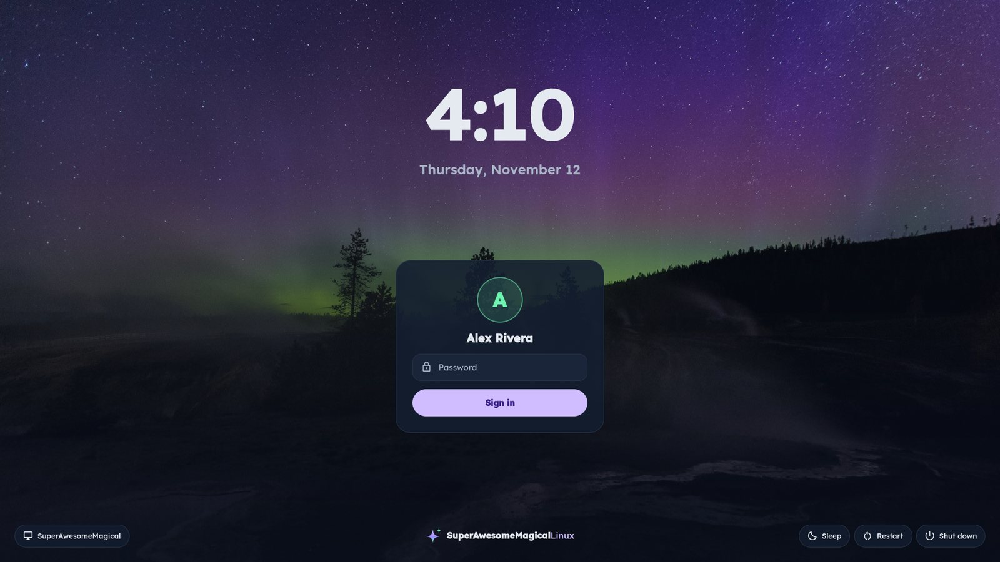
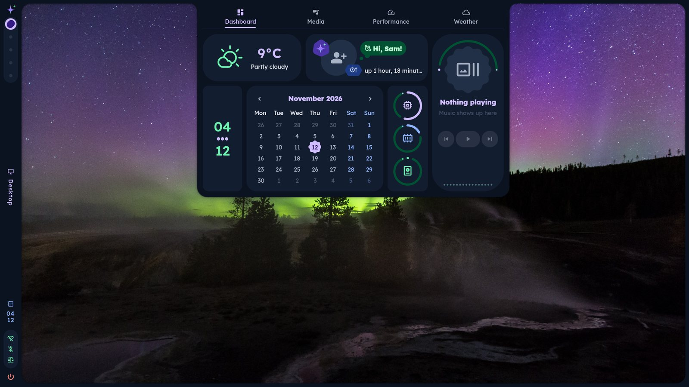
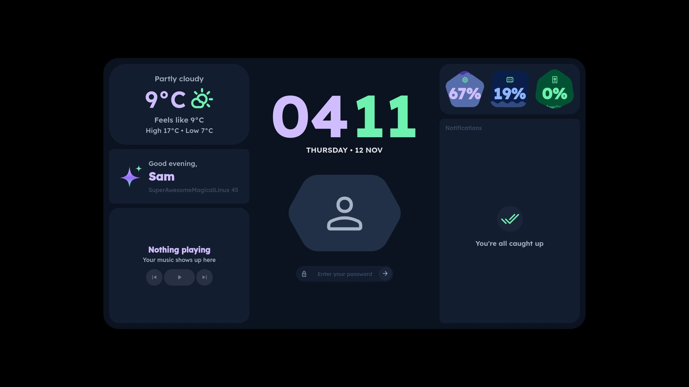
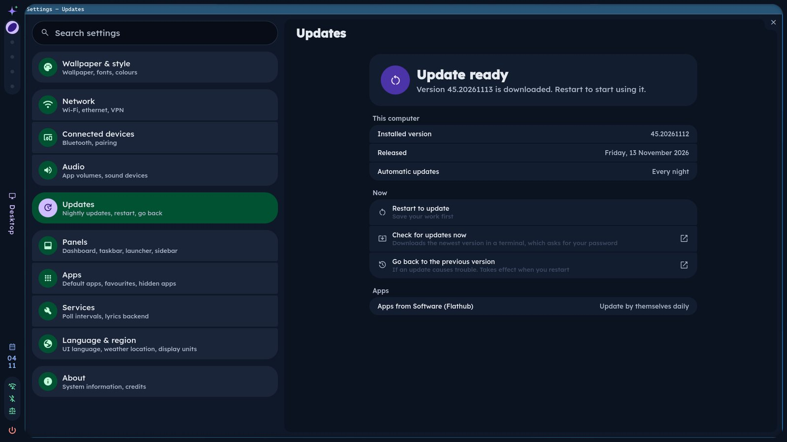

# SuperAwesomeMagicalLinux

The SuperAwesomeMagical ecosystem's operating system: Fedora, image-based, with a desktop in the
same look as the apps: Lexend everywhere, the brand's aurora purple and green over cool slate, soft
rounded cards.



| | |
|---|---|
|  |  |
|  | |

- **Stable.** The whole OS is one tested image. Updates download in the background and apply on
  the next restart, and if one ever misbehaves the previous version is one command away
  (`sudo bootc rollback`). Apps install from Flathub and update separately.
- **Fast.** Hyprland and the desktop shell are light, and Universal Blue's base brings hardware
  video decoding and codecs, so video plays on the GPU instead of the CPU.
- **Good looking.** Our own desktop shell, in Lexend (bold where it counts) and the
  SuperAwesomeMagical colours (aurora purple and green), with the SuperAwesomeMagical mark from the
  boot splash to the lock screen, a matching sign-in screen, and a photo of the northern lights over
  Yellowstone for the wallpaper. The original bright blue (Clear Sky) and Weather's themes (Harbor,
  Evergreen, Maple, Lupine, Aurora, Driftwood) are there to switch to.

## What's in it

| | |
|---|---|
| Base | Fedora 45 via [Universal Blue](https://universal-blue.org)'s `base-main` (codecs, firmware, drivers) |
| Desktop | [Hyprland](https://hypr.land) 0.57, set up as a normal floating desktop with our title bars, and the SuperAwesomeMagical shell (`shell/`, built on Quickshell) |
| Sign-in | SDDM with our own theme |
| The family's apps | [SuperAwesomeMagical Browser](https://github.com/603Madison/SuperAwesomeMagicalBrowser) (Firefox in the family's look, tabs down the side), [Music](https://github.com/603Madison/SuperAwesomeMagicalMusic) (the desktop app for your Music server) and [Email](https://github.com/603Madison/SuperAwesomeMagicalEmail) (your mail, signed in with Authentik; the handler for mail links), each its newest release |
| Apps | Files (Nautilus), Text Editor, Image Viewer, Terminal (foot, fish), mpv, Software (Flathub) |
| Fonts | Lexend (interface), Cascadia Code Nerd Font (code), Material Symbols (icons) |

## Installing

**From the ISO.** CI builds a fresh installer ISO after every image it publishes: open the latest
*Build installer ISO* run in the Actions tab, download the ISO from its Artifacts (they're kept for
3 days; *Run workflow* there makes a new one any time), write it to a USB stick (Fedora Media Writer
or `dd`), and boot it. The installer asks which disk to use and has you create your account.

The longest part is *Installing software*, which writes the whole system (about 12 GB) to the disk;
on a laptop's SSD from a USB 3 stick that's minutes. In a virtual machine it depends on the virtual
disk: give the VM a VirtIO disk with the host's write cache on and attach the ISO as a USB or VirtIO
drive rather than an emulated SATA CD-ROM, or it can take much longer.

**From another Fedora Atomic system** (Silverblue, Kinoite, Bazzite, Bluefin, ...):

```sh
sudo bootc switch ghcr.io/603madison/superawesomemagicallinux:latest
systemctl reboot
```

Either way, the system then follows `ghcr.io/603madison/superawesomemagicallinux:latest`, which
CI rebuilds every day with Fedora's latest updates, within a few hours of a new release of the
browser, Music or Email (so Firefox's security fixes arrive quickly), and after every change here.

## Updating

Nothing to do: every night the system downloads the newest image in the background and gets it
ready for the next restart, and Flatpak apps update themselves. When an update is ready, a
notification says so with a **Restart now** button. To update straight away instead, use **Check
for updates now** in Settings → About, or from a terminal:

```sh
superawesomemagical-update            # download now; it takes over at the next restart
superawesomemagical-update --reboot   # ...and restart into it
sudo bootc rollback                   # go back to the version before (then restart)
```

Your settings live in your home folder, so updates bring the new desktop without touching them.

## Using it

Windows work as on any desktop: they open floating and overlap, with a title bar to drag them by
(double-click it to maximize) and minimize, maximize and close buttons; drag any edge to resize.
Apps that draw their own title bar (GTK apps like Files) keep theirs, with the same three buttons.
The taskbar in the middle of the bar on the left has an icon for each window: click one to bring it
to the front, click the one in front to minimize it, click a faded (minimized) one to bring it back,
middle-click to close it.

`Super` opens the launcher. Some others (the rest are in
`/usr/share/superawesomemagical/hypr/caelestia/variables.lua` and `../desktop.lua`):

| Keys | |
|---|---|
| `Super` | Launcher |
| `Super + T` / `W` / `E` | Terminal / Browser / Files |
| `Alt + F4` or `Super + Q` | Close window |
| `Alt + Tab` | Switch window |
| `Super + Up` / `Down` | Maximize / minimize |
| `Super + 1`–`0` | Switch workspace |
| `Super + Alt + Space` | Tile a window (or float it again) |
| `Super + F` | Fullscreen |
| `Super + N` | Sidebar (notifications, quick settings) |
| `Super + L` | Lock (unlocks with a fingerprint too, once enrolled: `fprintd-enroll`) |
| `Super + Shift + S` | Screenshot a region |
| `Super + V` | Clipboard history |
| `Ctrl + Alt + Delete` | Session menu (log out, restart, shut down) |

**Changing things.** Colours and wallpaper are in the shell's dashboard, or from a terminal:

```sh
caelestia scheme set -n clearsky        # or superawesomemagical (the default), harbor, evergreen,
                                        #    maple, lupine, aurora, driftwood
caelestia scheme set -n dynamic         # colours from the wallpaper, Material You style
caelestia scheme set -m light           # light mode
```

Your own Hyprland changes go in `~/.config/caelestia/hypr-vars.lua` (settings) and
`~/.config/caelestia/hypr-user.lua` (anything else); the shell's settings are in
`~/.config/caelestia/shell.json`. Updates never touch these.

**Installing software.** Apps: the Software app (Flathub). Command-line and development tools: a
`distrobox` container (`distrobox create`, then `distrobox enter`, and `dnf install` inside it).
System packages can be layered with `rpm-ostree install`, but every layered package is something
updates have to work around, so prefer the other two.

## Building

CI (`.github/workflows/build.yml`) builds on every push, every day and whenever one of the
family's apps has a new release (`follow-apps.yml` checks every three hours), runs
the image's own checks, and publishes from the default branch; each publish then builds and checks
an installer ISO (`.github/workflows/build-iso.yml`). To build locally on Linux with podman and
[just](https://just.systems):

```sh
just build      # the image
just check      # its checks: programs, libraries, QML modules, fonts, branding
just iso        # an installer ISO in ./output
just qcow2      # a VM disk with an account, then `just vm` to boot it
```

How it's put together:

- `Containerfile`: three stages, the first two compiled against the image's own Qt. The first
  builds what the shell runs on, which rarely changes: Quickshell and two small libraries
  (`build_files/deps.sh`). The second builds the desktop shell from `shell/` and its command-line
  helper (`build_files/shell.sh`). The third installs Hyprland and the rest, lays our files over
  the top and makes the boot splash (`build_files/build.sh`, `build_files/plymouth.py`).
- `shell/`: the desktop shell, our fork of [Caelestia's](https://github.com/caelestia-dots/shell)
  (`shell/UPSTREAM.md` says where it came from and how to take in upstream changes).
- `system_files/`: copied onto the image as-is (sign-in theme, wallpapers, colour schemes,
  Hyprland entry config, session and update scripts, font and GTK defaults).
- `tools/`: regenerate the abstract wallpapers (`wallpapers.py`) and the colour schemes
  (`schemes.py`, which holds the brand's colour values); screenshot the shell without a GPU
  (`shell-preview/`, `just shell-preview`).

## Licence

GPL-3.0, like Caelestia's shell and Hyprland config, which ours grew from. Lexend and Material Symbols
are under the SIL Open Font Licence and Apache 2.0 respectively. The default wallpaper is *Aurora
borealis, Upper Geyser Basin* by NPS / Neal Herbert, a public-domain photo from Yellowstone National
Park (see `system_files/usr/share/backgrounds/superawesomemagical/CREDITS.md`).
